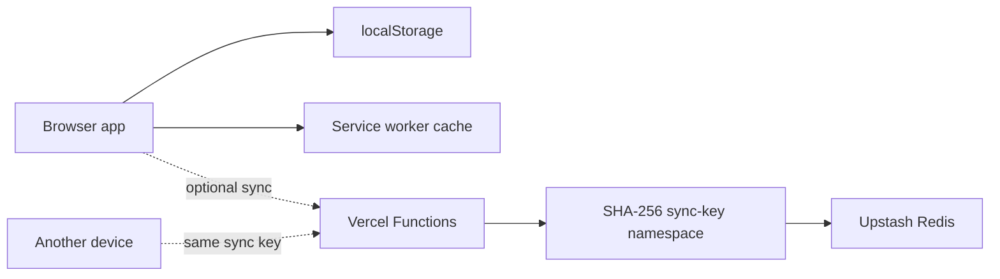
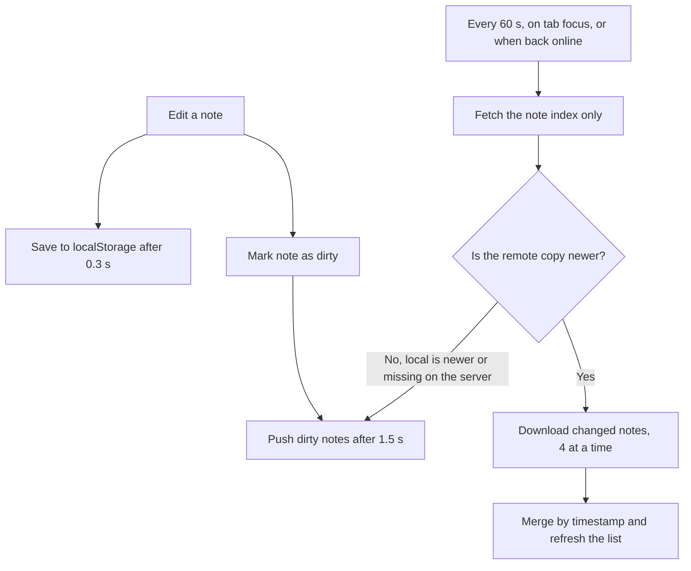
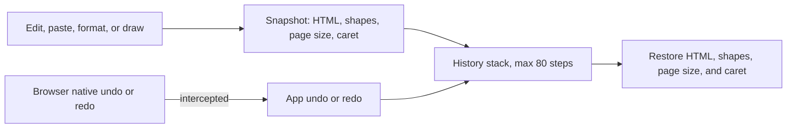
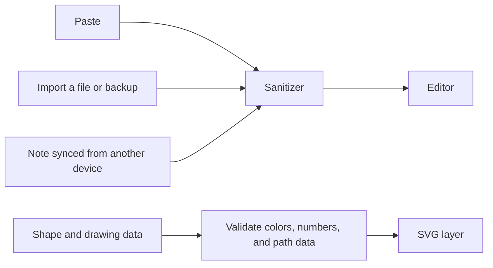

<div align="center">

<h1>Web Notepad</h1>

<p><strong>A local-first notepad for rich text, checklists, sketches, and quick capture — in your browser, no account needed.</strong></p>

<p>
  <a href="https://easynotepad.vercel.app"><strong>Live Demo</strong></a>
  ·
  <a href="#-run-locally">Run locally</a>
  ·
  <a href="#-enable-cloud-sync">Cloud sync</a>
  ·
  <a href="#-keyboard-shortcuts">Shortcuts</a>
</p>

<p>
  <a href="https://easynotepad.vercel.app"></a>
  <a href="LICENSE"></a>
  
  
  
</p>

</div>

<!--
DEMO: record a short GIF (writing, a checklist, a shape, dark mode) and save it as
docs/demo.gif, then uncomment the line below.

<p align="center"></p>
-->

Web Notepad saves notes in the current browser and works without an account. If you want your notes on another device, turn on optional cloud sync: the same sync key on each device, backed by Vercel Functions and Upstash Redis.

> **Security note:** Cloud sync is not end-to-end encrypted. Anyone who obtains a sync key can read and change the notes stored under it. Don't store passwords, credentials, or other sensitive information in this app.

## 👀 Quick look

| | |
| --- | --- |
| **What it is** | A local-first notepad: rich text, checklists, shapes and drawing, print/PDF, and optional cloud sync |
| **Try it** | [easynotepad.vercel.app](https://easynotepad.vercel.app) — no sign-up needed |
| **Stack** | Vanilla JavaScript · HTML/CSS · Vercel Functions · Upstash Redis · installable PWA |
| **Engineering highlights** | • Single-file frontend (~50 KB), no framework and no build step<br>• Custom undo/redo that covers text, checklists, shapes, and page size<br>• SVG shape and freehand-drawing editor with move and resize<br>• Per-note last-write-wins sync, with tombstones for deletions<br>• Installable PWA with an offline app shell<br>• Keyboard-navigable toolbars and menus, reduced-motion support |
| **Read first** | [Features](#-features) · [How it works](#-how-it-works) · [Technical decisions](#-technical-decisions) · [Limits](#-data-privacy-and-limits) |
| **Code to look at** | `public/index.html` (sanitizer, sync, drawing, and undo/redo sections) · `api/notes.js` · `api/health.js` |

## ✨ Features

### ✍️ Writing and organization

- Create, edit, search, pin, and delete multiple notes; search matches titles and note text.
- Saves automatically as you type, plus an explicit save shortcut.
- Paragraph, three heading levels, quote, and code block styles; bold, italic, underline, strikethrough, text color, and highlight color.
- Bulleted and numbered lists, left/center/right alignment, links, and a clear-formatting button.
- Checklists: todo lines (press Enter for the next item) and inline checkboxes that strike through when ticked.
- Paste formatted content or plain text. Pasted and imported HTML goes through a lightweight sanitizer before insertion.
- Paste images straight from the clipboard.
- Find and replace, focus mode, a choice of Sans, Serif, or Mono editor font, and zoom from 25% to 300%.
- Live word count, character count, and estimated reading time.
- Light and dark themes; the first load follows your operating-system preference.

### 🎨 Page layout and drawing

- Free-size pages, or A4, A4 landscape, A3, A3 landscape, A5, Letter, and Legal.
- Freehand pen and eraser, plus rectangles, rounded boxes, ellipses, triangles, diamonds, stars, lines, and arrows.
- Select, move, resize, restyle, and delete shapes; choose line color, fill color, fill or outline, and thin/medium/thick lines.
- Print a note or save it as PDF through the browser's print dialog.

### 🔄 Import, export, and sync

- Import `.txt`, `.md`, `.html`, and `.htm` files as new notes.
- Export a note as `.txt` or `.html`; copy content with formatting or as plain text.
- **Backup all** writes every live note to a dated JSON file (`notepad-backup-YYYY-MM-DD.json`); importing a backup restores its notes as new notes.
- Sync across devices with the same key; deletions propagate as tombstones.
- Conflicts are resolved per note by timestamp. This is not real-time collaborative editing.

## 🚀 Quick start

**Just use it:** open **[easynotepad.vercel.app](https://easynotepad.vercel.app)**. Nothing to install or sign up for. Tip: `/?new=1` opens straight into a fresh note.

**Take a look locally:** open `public/index.html` in a browser for a quick UI check (local notes only — the `/api/*` functions don't run this way). For the full app including sync, see [Run locally](#-run-locally).

## 🧩 How it works



- **Storage:** every note is saved to `localStorage` shortly after you stop typing. Sync is optional.
- **Sync flow:** the app asks the server for a compact note index, downloads only the notes that changed (in small parallel batches), and uploads local changes. It re-syncs roughly every minute while the page is visible, when you return to the tab, and when the browser comes back online.
- **Namespace:** the server hashes the sync key with SHA-256 to pick a Redis namespace. **Hashing identifies the namespace; it does not encrypt note content.**
- **Offline:** the service worker caches the app shell (not `/api/` requests). Offline, you have the interface and the notes already stored on that device; sync needs a connection.

### 🧰 Tech stack

| Layer | Technology |
| --- | --- |
| Frontend | HTML, CSS, vanilla JavaScript (`contenteditable` editor, SVG shapes and drawing) |
| API | Node.js serverless functions on Vercel |
| Cloud storage | Upstash Redis via `@upstash/redis` |
| Local persistence | Browser `localStorage` |
| Offline / install | Service worker and Web App Manifest |
| Hosting | Vercel |

`@upstash/redis` is the only npm dependency, and only the API functions use it.

## 🧠 Technical decisions

A notepad looks simple, but several parts are harder than they appear. These are the main decisions behind the client code, what each one solves, and what it costs. To follow along in the source, search `public/index.html` for the section comments: *Sanitizer*, *Backend sync*, *Undo / redo*, and *shapes and freehand drawing*.

### 1. Sync without accounts, and without losing notes

**Challenge.** Let people use the same notes on several devices with no sign-up, and never lose an edit when the network drops or two devices disagree.

**Decision.**

- **Local first.** Every edit is saved to `localStorage` shortly after you stop typing, so the app works with no server at all. Sync is an add-on, not a dependency.
- **Dirty tracking.** A changed note stays "dirty" until it has been pushed, and pushes happen about 1.5 seconds after the last edit. Temporary failures (network, server) keep the note dirty and it is retried. Permanent ones (a note that is too large, a rejected note, the 500-note limit) don't loop forever; they show a clear message.
- **Cheap pulls.** The client fetches only a compact index of notes, downloads just the ones that are newer than its local copy (four at a time), and pushes anything the server has older or is missing. This runs every 60 seconds while the tab is visible, when you return to the tab, and when the browser comes back online. A guard stops two syncs from overlapping.
- **Conflicts and deletions.** Each note resolves by timestamp, last write wins. Deleted notes become tombstones, so a deletion on one device isn't undone by another.
- **A shared key that is easy to check.** The app normalizes the sync key and shows a short **Key ID** (the first bytes of its SHA-256 hash), so two devices can be compared without revealing the key. The share link carries the key in the URL fragment, which the app removes from the address bar after reading, and it asks before merging if a different key is already active.
- The starter "Welcome" note is dropped automatically once real synced notes arrive, so a new device doesn't start with clutter.



**Trade-off.** Per-note last-write-wins using device clocks is simple and predictable, but concurrent edits to the same note can overwrite each other, and badly skewed clocks can pick the wrong winner. Real-time collaborative editing would need a different model (CRDT or operational transforms), which was out of scope.

### 2. One undo history for text, checklists, shapes, and page size

**Challenge.** The browser's built-in undo only understands text edits inside the editor. It knows nothing about shapes, drawings, or page-size changes, so undoing after drawing would do the wrong thing.

**Decision.** The app keeps its own snapshot history. Each snapshot stores the note's HTML, its shape and drawing data, the page size, and the caret position. Snapshots are recorded shortly after changes and explicitly before actions like paste and formatting. The browser's native undo and redo events are intercepted and routed through this history, and on restore the caret is placed back by text offset. Memory is bounded: 80 steps per note, reduced to 15 for very large notes.



**Trade-off.** Full snapshots are simpler and more reliable than diffs, but use more memory on large notes, which is why the history is capped.

### 3. Treat everything from outside as untrusted

**Challenge.** A rich-text editor takes HTML from many places: the clipboard, imported files, backup JSON, and notes synced from another device. Any of them can carry scripts or malformed data.

**Decision.**

- All HTML goes through a sanitizer that removes scripts, styles, iframes, objects, embeds, forms, and similar elements, plus event-handler attributes and `javascript:` links. It runs on paste, file import, and backup restore, **and again when a note is opened**, so content synced from elsewhere is cleaned too.
- Plain-text paste is escaped and converted to HTML in a way that keeps line breaks, tabs, and repeated spaces.
- Shape and drawing data is validated separately before it reaches the SVG layer: colors must match a hex pattern, numbers are coerced, shape names are reduced to word characters, and freehand path data is restricted to path commands and digits.



**Trade-off.** The sanitizer is blocklist-based: lightweight and dependency-free, but an allowlist library such as DOMPurify is stricter and is listed as a next step.

### 4. A drawing layer that stays accurate under zoom and print

**Challenge.** Shapes and pen strokes sit on top of editable text. They have to stay editable, land under the pointer at any zoom level, and print on the right page size.

**Decision.**

- Shapes and strokes are stored as **data** (JSON saved with the note), not as pictures, so they stay selectable, movable, and resizable, and they sync like any other note content.
- Pointer coordinates are converted back through the zoom factor, so shapes land under the pointer from 25% to 300%. Pointer capture and disabled touch scrolling on the drawing layer keep drawing and dragging smooth on touch screens.
- Page sizes (A4, A3, A5, Letter, Legal, and landscape variants) are CSS-based, and a matching print page size is generated for the selected size, so print and Save as PDF follow the on-screen page. At 100% zoom, paper-sized pages scale down to fit the screen.

**Trade-off.** The eraser tests distance to recorded stroke points. That is fast and simple, but less precise on very fast strokes whose points are far apart.

## 💻 Run locally

**Requirements:** Node.js 18 or later (a current LTS release is recommended), npm, and the Vercel CLI.

```bash
git clone https://github.com/hamzabhulla/web-notepad.git
cd web-notepad
npm install
npm install --global vercel
vercel dev
```

Open the local URL that Vercel prints, usually `http://localhost:3000`.

Local note-taking works without Redis. To test cloud sync locally, connect an Upstash Redis database to the Vercel project and make these variables available to the local process:

```dotenv
UPSTASH_REDIS_REST_URL=your_redis_rest_url
UPSTASH_REDIS_REST_TOKEN=your_redis_rest_token
```

Pull them with the Vercel CLI or put them in a local `.env` file. **Never commit `.env` files or expose these credentials.**

## 🌐 Deploy to Vercel

1. Import the repository into a Vercel project.
2. Choose **Other** as the framework preset and leave the build command empty. `vercel.json` already sets `public` as the output directory.
3. Deploy. The frontend is static; the `api/` directory holds the Vercel Functions.
4. To enable sync, connect an Upstash Redis database and set `UPSTASH_REDIS_REST_URL` and `UPSTASH_REDIS_REST_TOKEN` for the deployment.
5. Redeploy after changing the storage integration or environment variables.
6. Open `https://YOUR-DOMAIN/api/health` — a healthy, configured service reports storage as `configured` and Redis as `ok`.

If Deployment Protection blocks a preview URL, use the production domain or adjust the protection settings for the deployment you intend to use.

## 🔄 Enable cloud sync

1. In the app, click **Sync: off** to open **Cloud sync**.
2. Click **Generate**, or enter a key of 16–128 letters, numbers, underscores, or hyphens. Keys are lowercased and stripped of whitespace.
3. Click **Save & sync**.
4. On another device, enter the same key or open the **Share sync link**. Check that the **Key ID** matches on both devices.
5. Use **Sync now** any time, or **Test connection** if something looks wrong.

A sync key is a bearer secret: anyone who has it can access the notes. The share link carries the key in its URL fragment, so sending the link shares access. The app removes the fragment from the address bar after reading it.

**Turn off** disables sync on that device only; it doesn't delete local or remote notes.

## 📲 Install and use offline

Open the deployed HTTPS site in a supported browser and use **Install app** (or the browser's install prompt). On iPhone or iPad, choose **Share → Add to Home Screen**. The installed app also offers a **New note** shortcut.

After the app shell has loaded once online, the service worker can reopen the interface offline. Only notes already stored on that device are available offline.

## ⚡ Keyboard shortcuts

<details>
<summary><strong>Show all shortcuts</strong></summary>

| Shortcut | Action |
| --- | --- |
| `Ctrl/Cmd + S` | Save locally and push pending changes to sync |
| `Alt + N` | New note |
| `Ctrl/Cmd + H` | Find and replace |
| `Ctrl/Cmd + Z` | Undo |
| `Ctrl/Cmd + Y` or `Ctrl/Cmd + Shift + Z` | Redo |
| `Ctrl/Cmd + B` / `I` / `U` | Bold / italic / underline |
| `Ctrl/Cmd + P` | Print (opens the browser print dialog) |
| `Ctrl/Cmd + +` / `-` / `0` | Zoom in / out / reset while the editor is focused |
| `Ctrl/Cmd + mouse wheel` | Zoom the page |
| `Enter` on a todo line | Add the next todo; on an empty todo, leave the list |
| `Tab` / `Shift + Tab` | Indent / outdent list items (four spaces elsewhere) |
| `Delete` / `Backspace` | Delete the selected shape (when the editor isn't focused) |
| `Esc` | Close menus and find bar, and leave focus mode |

Use `Cmd` on macOS. Some shortcuts vary by browser or operating system.

</details>

## 📡 API reference

<details>
<summary><strong>Endpoints, authentication, and error codes</strong></summary>

All endpoints are Vercel serverless functions in `api/`. Sync requests send the key in an `x-sync-key` header.

| Method and path | Purpose | Authentication |
| --- | --- | --- |
| `GET /api/health` | Reports API/storage configuration and checks Redis connectivity | None |
| `GET /api/notes?meta=1` | Returns note metadata without note bodies | `x-sync-key` |
| `GET /api/notes?id=NOTE_ID` | Returns one note | `x-sync-key` |
| `GET /api/notes` | Returns the note collection | `x-sync-key` |
| `PUT /api/notes` | Creates or updates a note from a JSON body: `{ "note": { ... } }` | `x-sync-key` |

The sync key must be 16–128 characters. The API hashes it with SHA-256 to derive the storage namespace; note content is not end-to-end encrypted.

Error codes the app understands:

| Code | Meaning |
| --- | --- |
| `storage_not_configured` | Upstash Redis isn't connected to the Vercel project (or it wasn't redeployed) |
| `invalid_sync_key` | The key doesn't meet the format rules |
| `note_too_large` | One note exceeds the size limit, usually because of large embedded images |
| `too_many_notes` | The 500-note limit for the key was reached |
| `bad_note` | The note payload was rejected |
| `server_error` | Server or database error (may include a `detail` message) |

</details>

## 🔒 Data, privacy, and limits

- **Local-only mode:** notes live in `localStorage` for this site and browser profile; they don't appear in other browsers or devices on their own. The sync key, theme, font, and zoom preferences are stored there too.
- **Synced mode:** note data — including formatted HTML and drawing metadata — is stored in the connected Upstash Redis database.
- **Third parties:** the frontend loads no analytics or third-party scripts. The only external request is the Inter web font from Google Fonts, with system fonts as the fallback.
- **Access control:** anyone with a sync key can access that key's notes. A sync key is not a replacement for user accounts.
- **Conflicts:** edits resolve per note by last-write-wins using each device's clock, so concurrent edits to the same note can overwrite each other, and badly skewed clocks can pick the wrong winner.
- **Deletion:** tombstones propagate deletions between devices. Turning sync off deletes nothing.
- **Limits:** up to 500 notes per sync key; note HTML up to 3,000,000 characters and extra metadata up to 500,000 characters. Large embedded images can exceed sync limits. Undo history keeps the last 80 steps per note (15 for very large notes).
- **Backups:** cloud sync is not a backup. Use **Backup all** and store the file somewhere safe.
- **Transport:** use HTTPS for any deployed site, especially when entering or sharing a sync key.

## 🩹 Troubleshooting

<details>
<summary><strong>Sync problems and missing notes</strong></summary>

**Sync can't reach the server**

1. Open **Cloud sync → Test connection**.
2. Visit `https://YOUR-DOMAIN/api/health` and look for storage `configured` and Redis `ok`.
3. Confirm Upstash is connected and the environment variables are set for the right Vercel environment, then redeploy.
4. Confirm both devices show the same **Key ID**.

**"The sync function (/api/notes) was not found"**

Deploy the whole project, including the `api/` folder.

**Vercel blocks the app on a phone**

Open the production domain instead of a protected preview URL, or change Deployment Protection for that deployment. Also check for a VPN or ad-blocker if the connection test fails.

**A note won't sync**

Check the limits above and remove large embedded images. **Test connection** helps tell a service problem from a note-size problem.

**Notes seem to be missing**

For local-only notes, check the original browser profile. For synced notes, confirm the same Key ID is active on both devices. Before clearing site data, make sure you have a recent JSON backup. If you see "Browser storage is full", download your notes and remove large images.

</details>

## 📁 Project structure

```text
web-notepad/
├── api/
│   ├── health.js       # API and Redis health check
│   └── notes.js        # Cloud note read/write API
├── public/
│   ├── index.html      # The whole single-page app (HTML, CSS, JS)
│   ├── manifest.json   # Installable app metadata and "New note" shortcut
│   ├── sw.js           # Offline app-shell cache
│   └── *.png           # App icons
├── package.json        # Node requirement and the Redis dependency
├── vercel.json         # Output directory and service-worker headers
├── LICENSE
└── README.md
```

## 🚧 Known limitations and ideas

- The editor is built on `contenteditable` and `document.execCommand`. It works across current browsers, but that API is deprecated and small behavior differences between browsers are possible.
- The HTML sanitizer is intentionally lightweight (it removes scripts, iframes, event handlers, and `javascript:` URLs). Swap in a dedicated library such as DOMPurify before using this with untrusted content at scale.
- Sync is per-note last-write-wins, not collaborative editing.
- Possible next steps: end-to-end encrypted sync, automated tests, and a hardened sanitizer.

## 🤝 Contributing

Issues and pull requests are welcome. For code changes, please keep the no-build-step approach, describe how you tested, and never commit `.env` files or credentials.

## 📄 License

Released under the [MIT License](LICENSE).

## 👤 Author

Made by [Hamza Bhulla](https://github.com/hamzabhulla).
