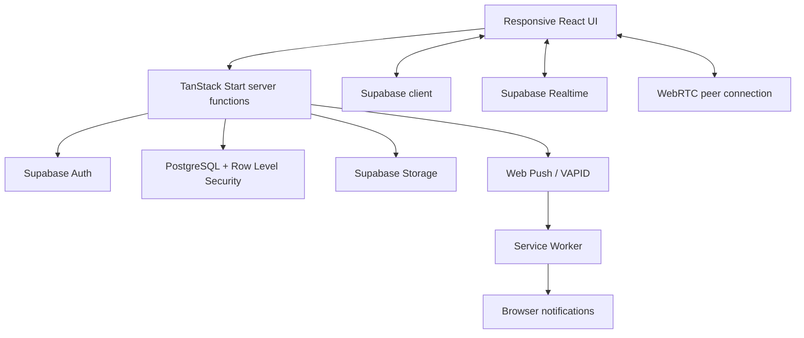

# VibeTalk

**Chat at the speed of thought — real-time messaging, voice notes, and calls in a responsive web app.**

[](https://vibetalk.hamzabhulla.workers.dev)
[](https://vibetalk.hamzabhulla.workers.dev/VibeTalk.apk)
[](LICENSE)


[](https://vibetalk.hamzabhulla.workers.dev)

VibeTalk is a full-stack messaging app built with **React, TypeScript, TanStack Start, and Supabase**. It combines direct messages, group rooms, live presence, voice notes, WebRTC voice/video calls, reactions, read receipts, and push notifications in one interface designed for both desktop and mobile.

> **Project status:** Portfolio / active development. Some features depend on your Supabase schema, auth settings, push credentials, and hosting configuration — see [Getting started](#getting-started) and [Security notes](#security-and-privacy-notes) before deploying your own instance.

## Try it

| | |
| --- | --- |
| 🌐 **Web app** | [vibetalk.hamzabhulla.workers.dev](https://vibetalk.hamzabhulla.workers.dev) — [sign up](https://vibetalk.hamzabhulla.workers.dev/register) with your email, or [sign in](https://vibetalk.hamzabhulla.workers.dev/login) |
| 🤖 **Android** | [Download the APK](https://vibetalk.hamzabhulla.workers.dev/VibeTalk.apk) (Android 7.0+, ~11 MB). You may need to allow "install from unknown sources" for your browser once. The SHA-256 checksum is published on the [landing page](https://vibetalk.hamzabhulla.workers.dev/#download). |

<!--
SCREENSHOTS: add 3-4 real screenshots or a short GIF to docs/screenshots/ and
uncomment this block.

## Screenshots

| Chat | Voice notes | Rooms |
| --- | --- | --- |
|  |  |  |
-->

## Features

**Messaging**
- Direct conversations and group rooms with live updates and membership controls
- Emoji reactions, message editing/deletion, copy controls, and read-receipt details
- Typing status, online/last-seen presence, and unread counts
- Pin and mute conversations to keep your inbox organised

**Voice and calls**
- Record and play voice notes, with server-side checks for attachment ownership and allowed MIME types
- Browser-based WebRTC voice/video calls with call invitations, history, and status handling

**Privacy and security**
- Private, invite-controlled rooms and private profile discovery
- Configurable notification previews
- Optional end-to-end encrypted **group text** (AES-GCM with per-recipient wrapped message keys) — see [limits](#security-and-privacy-notes)

**Accounts and notifications**
- Registration, sign-in, password reset/change, profile editing, visibility settings, and account deletion
- Service-worker push notifications with per-device subscriptions and test notifications

**Platform**
- Responsive desktop and mobile layouts (profile, people, rooms, and calls views)
- Web app plus an Android APK
- Separate Cloudflare Workers and Vercel build targets with parity checks to prevent stale or mismatched deployments

## Tech stack

| Area | Technologies |
| --- | --- |
| UI | React 19, TypeScript, Tailwind CSS 4, Radix UI, Lucide |
| Framework | TanStack Start, TanStack Router, TanStack React Query, Vite |
| Backend and data | Supabase Auth, PostgreSQL, Row Level Security, Realtime, Storage |
| Calls | WebRTC with STUN/TURN configuration |
| Notifications | Service Worker, Web Push, VAPID |
| Forms and validation | Zod, React Hook Form |
| Hosting | Cloudflare Workers (live demo), Vercel (supported target) |
| Code quality | TypeScript checks, ESLint, Prettier, build/config guard scripts |

## Architecture



- **Client:** React routes and components handle the responsive UI, realtime subscriptions, media capture, and browser APIs.
- **Server:** TanStack Start server functions run authenticated operations and keep privileged service-role access server-side.
- **Data:** Supabase provides auth, relational data, storage, and realtime events. Row Level Security is part of the authorization boundary.
- **Calls:** WebRTC handles the peer connection; signaling and call state go through the app and Supabase-backed functions/channels.
- **Notifications:** The service worker handles background notifications; server-side Web Push uses VAPID credentials.

## Getting started

### Prerequisites

- Node.js 22 (or a compatible supported release) and npm
- A Supabase project with the required schema, policies, storage, and auth settings
- *Optional:* VAPID keys for background push notifications
- *Optional:* a restricted, rate-limited TURN credential for calls across restrictive networks

### 1. Clone and install

```bash
git clone https://github.com/hamzabhulla/VibeTalk.git
cd VibeTalk
npm ci
```

### 2. Configure environment variables

```bash
cp .env.example .env
```

| Variable | Purpose |
| --- | --- |
| `SUPABASE_URL` | Supabase project URL used by server-side code |
| `SUPABASE_PUBLISHABLE_KEY` | Publishable key used by the server-side Supabase client |
| `VITE_SUPABASE_URL` | Supabase URL compiled into the browser bundle; must match `SUPABASE_URL` |
| `VITE_SUPABASE_PUBLISHABLE_KEY` | Browser-facing publishable key |
| `VITE_SUPABASE_PROJECT_ID` | Project identifier used by client configuration |
| `VAPID_PUBLIC_KEY` | Public VAPID key for Web Push |
| `VITE_VAPID_PUBLIC_KEY` | Build-time VAPID public key; keep it paired with the server key |
| `VAPID_SUBJECT` | *Optional* VAPID contact URL |
| `VITE_TURN_URLS` | *Optional* STUN/TURN server URL(s) for WebRTC |
| `VITE_TURN_USERNAME` | *Optional* TURN username |
| `VITE_TURN_CREDENTIAL` | *Optional* TURN credential — anything prefixed `VITE_` is exposed in the client bundle |

> **Never** put privileged credentials in `.env.example`, source control, screenshots, issue reports, or `VITE_` variables. `SUPABASE_SERVICE_ROLE_KEY` and `VAPID_PRIVATE_KEY` belong in your hosting provider's secret store only.

The server-side and browser-side Supabase values must point to the **same project** — a mismatch causes auth failures that look like session bugs.

### 3. Set up Supabase

1. Create or select a Supabase project.
2. Apply the SQL in `supabase/migrations/` in order, using your normal Supabase migration workflow.
3. Review the extra `supabase/vibetalk-*.sql` files before applying them. They include audit/fix scripts and consolidated snapshots — **do not blindly run every SQL file**, as some overlap.
4. Confirm Row Level Security protects profiles, rooms, memberships, messages, reactions, calls, and other user-scoped data.
5. Set your Supabase Auth site and redirect URLs for local and production domains.
6. Add the required server secrets to your host before enabling push or any privileged database access.

[`AGENTS.md`](AGENTS.md) documents additional deployment and Supabase dashboard assumptions — read it before changing security-sensitive configuration.

### 4. Run locally

```bash
npm run dev
```

For a production-style build and preview:

```bash
npm run build
npm run preview
```

## Scripts

| Command | Description |
| --- | --- |
| `npm run dev` | Start the Vite dev server |
| `npm run typecheck` | Run the TypeScript compiler without emitting files |
| `npm run lint` | Lint source, scripts, Vite configs, and the service worker |
| `npm run build` | Type-check, verify config/header parity, and build the Cloudflare target |
| `npm run build:vercel` | Clean stale output, run guards, and build the Vercel target |
| `npm run deploy:build` | Run both production builds and their guard checks |
| `npm run build:dev` | Development build into a separate, non-deployable output directory |
| `npm run check:vite-parity` | Check Cloudflare and Vercel Vite configs stay aligned |
| `npm run check:security-headers-parity` | Check security-header parity across hosts |
| `npm run format` | Format with Prettier |

## Deployment

VibeTalk ships build configuration for **Cloudflare Workers** (used by the live demo) and **Vercel**. Guard scripts compare configuration and security headers and help prevent stale output from being deployed.

Before deploying:

1. Set all environment variables and server-side secrets on the target host.
2. Make sure Supabase Auth redirect URLs and the browser/server Supabase configuration match the deployment.
3. Follow the build/deploy sequence in [`AGENTS.md`](AGENTS.md) for your host.
4. Verify the service worker, auth, realtime messaging, calls, and push notifications after deploying.
5. Never deploy a development build or a stale output directory.

## Security and privacy notes

- Authorization is enforced on the server and in Supabase Row Level Security — client-side checks are not a security boundary.
- Service-role credentials and VAPID private keys stay server-side. `VITE_*` variables are visible in the compiled bundle.
- Optional E2EE applies to **text messages in newly created group rooms where E2EE is enabled**. Attachments and voice notes are **not** covered by that layer, so the app as a whole should not be described as end-to-end encrypted.
- WebRTC call security and text-message E2EE are separate concerns; review the call/signaling threat model before making security claims about calls.
- Review the SQL migration history and the threat-model notes in `AGENTS.md` before production use.

This README describes the implementation in the repository. It is not a security audit or a guarantee that any deployment is correctly configured.

## Project structure

```text
.
├── public/                   # Static assets, service worker, Android APK, social preview
├── scripts/                  # Build, deployment, and parity guard scripts
├── src/
│   ├── components/           # Chat UI, call overlay, voice notes, profile and mobile UI
│   ├── hooks/                # Shared React hooks
│   ├── integrations/supabase/# Supabase clients, auth middleware, generated types
│   ├── lib/                  # Server functions, calls, E2EE, push, uploads, security helpers
│   ├── routes/               # Landing, auth, rooms, people, calls, and profile routes
│   ├── server.ts             # Server entry and error handling
│   └── router.tsx            # Router setup
├── supabase/
│   ├── migrations/           # Ordered database migrations
│   └── vibetalk-*.sql        # Additional SQL scripts and consolidated snapshots
├── AGENTS.md                 # Architecture, security, and deployment rules
├── .env.example              # Environment template (no secret values)
├── vite.config.ts            # Cloudflare-targeted Vite config
└── vite.config.vercel.ts     # Vercel-targeted Vite config
```

## Known limitations

- Push notifications need correct VAPID configuration, a working service worker, browser permission, and host-side secrets.
- Calls behind restrictive NATs or firewalls may need valid STUN/TURN configuration.
- TURN settings are currently client-provided; don't embed privileged or long-lived TURN credentials in the client bundle.
- E2EE covers group text only (see above).
- There is no automated test suite yet — type-checking, linting, and build guard scripts are available.

## Roadmap

- Automated tests for authorization boundaries, messaging, E2EE envelope handling, push delivery, and call lifecycle edge cases
- Browser end-to-end tests for sign-up, direct/group messaging, attachments, notifications, and calling
- Ephemeral, server-minted TURN credentials
- Key lifecycle and multi-device recovery for E2EE
- A repeatable clean-environment database bootstrap and deployment verification checklist

## Contributing

Issues and pull requests are welcome. For a change:

1. Open an issue describing the problem or proposed behavior.
2. Keep authorization checks on the server and in database policies.
3. Run `npm run typecheck`, `npm run lint`, and the relevant build checks.
4. Include tests or reproducible verification steps for behavior changes.
5. Don't commit `.env`, secrets, local Wrangler state, generated output, or personal data.

## License

Released under the [MIT License](LICENSE).

## Author

Made by **Hamza Bhulla** — [@hamzabhulla](https://github.com/hamzabhulla)

Built with React, TypeScript, TanStack, Supabase, Tailwind CSS, Radix UI, and the wider open-source ecosystem.
