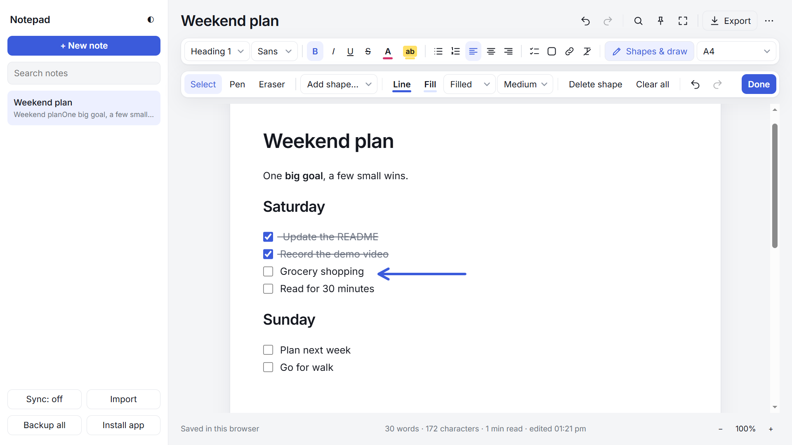
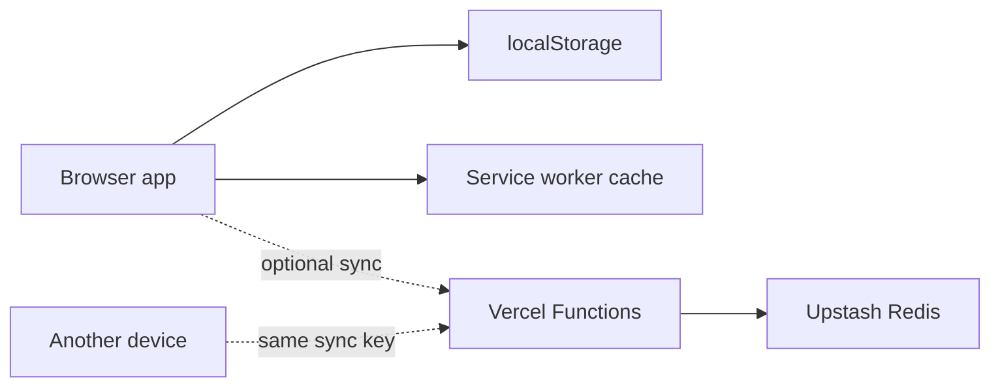

<div align="center">

<h1>Web Notepad</h1>

<p><strong>A local-first notepad for rich text, checklists, and sketches. It works offline, installs as an app, and can sync across devices with a private key.</strong></p>

<p>
  <a href="https://easynotepad.vercel.app"><strong>Live Demo</strong></a>
  &nbsp;·&nbsp;
  <a href="https://github.com/hamzabhulla/web-notepad"><strong>Source Code</strong></a>
  &nbsp;·&nbsp;
  <a href="docs/ENGINEERING.md">Engineering Notes</a>
  &nbsp;·&nbsp;
  <a href="#getting-started">Getting Started</a>
</p>

<p>
  <a href="https://easynotepad.vercel.app"></a>
  <a href="LICENSE"></a>
  
  
</p>

</div>

<!--
SCREENSHOT: save a clean 1600x1000 screenshot (light theme, one sample note with a
checklist and a shape) as docs/screenshot.png, then replace this comment with:

<p align="center"></p>
-->

## Overview

Web Notepad stores notes in the browser, so it works without an account or a server. Optional cloud sync lets the same notes follow you between devices with a shared sync key, backed by Vercel Functions and Upstash Redis. The app is plain HTML, CSS, and JavaScript, with no framework and no build step.

> **Security note:** Cloud sync is not end-to-end encrypted. Anyone who has a sync key can read and change the notes stored under it. Don't store passwords or other sensitive information in this app.

## Features

**Writing**
- Multiple notes with search, pinning, autosave, and live word and character counts
- Headings, quotes, code blocks, lists, text and highlight colors, and links
- Checklists, find and replace, focus mode, and zoom from 25% to 300%
- Light and dark themes

**Drawing and pages**
- Freehand pen and eraser, plus eight editable shape types
- Free-size, A3, A4, A5, Letter, and Legal pages (A3 and A4 also in landscape), with print and PDF export

**Data and sync**
- Import `.txt`, `.md`, and `.html`; export `.txt` and `.html`; full JSON backup and restore
- Optional cloud sync between devices with a private key
- Installable as an app, with [keyboard shortcuts](docs/SHORTCUTS.md)

## Architecture



- **Storage:** every note is saved to `localStorage`; sync is optional.
- **Sync:** the client downloads only changed notes and pushes local changes. The server hashes the sync key with SHA-256 to choose a Redis namespace. Hashing identifies the namespace; it does not encrypt note content.
- **Offline:** a service worker lets the installed app reopen without a network. Sync needs a connection.

## Engineering decisions

Five decisions shaped the app. Each is summarized here; the longer write-up, with diagrams, is in [docs/ENGINEERING.md](docs/ENGINEERING.md).

### 1. Local-first architecture
- **Challenge:** notes should be available instantly and never depend on a server or an account.
- **Solution:** every edit is saved to `localStorage` shortly after typing stops. Sync is an optional layer on top.
- **Trade-off:** browser storage is limited and per-browser, so the app offers **Backup all** and warns when storage is full.

### 2. Offline support and PWA
- **Challenge:** open and edit with no connection, and feel like an app on phones and desktops.
- **Solution:** a web manifest (standalone display, icons, and a "New note" shortcut), a service worker for the app shell, an in-app install prompt, and Add to Home Screen guidance on iOS.
- **Trade-off:** offline use covers the app shell and notes already on the device. Sync needs a connection, and installation needs HTTPS.

### 3. Undo and redo history
- **Challenge:** the browser's built-in undo ignores shapes, drawings, and page size.
- **Solution:** an app-level history of snapshots (note HTML, shapes, page size, and caret position), capped at 80 steps per note (15 for very large notes).
- **Trade-off:** full snapshots are simpler and more reliable than diffs, but use more memory, hence the cap.

### 4. Handling pasted and imported HTML
- **Challenge:** HTML arrives from the clipboard, imported files, backups, and other synced devices.
- **Solution:** a sanitizer removes scripts, iframes, forms, event-handler attributes, and `javascript:` links on paste, import, restore, and whenever a note is opened. Drawing data is validated separately.
- **Trade-off:** the sanitizer is blocklist-based. An allowlist library such as DOMPurify would be stricter.

### 5. Cloud-sync conflict resolution
- **Challenge:** two devices can edit the same note while offline.
- **Solution:** per-note last-write-wins by timestamp, a metadata-first pull that downloads only changed notes, retry for failed pushes, tombstones for deletions, and a short Key ID to confirm devices share a key.
- **Trade-off:** it relies on device clocks, and concurrent edits to one note can overwrite each other. This is not real-time collaboration.

## Project facts

| Fact | Detail | Where to verify |
| --- | --- | --- |
| Frontend dependencies | None. The only external request is the Inter web font, with system fonts as the fallback | `public/index.html` |
| Runtime npm dependencies | 1: `@upstash/redis`, used only by the API functions | `package.json` |
| Build step | None; `vercel.json` serves `public/` directly | `vercel.json` |
| App size | About 50 KB uncompressed, in a single HTML file | `public/index.html` |
| Node.js | 18 or later | `package.json` |
| Notes per sync key | 500 | [docs/API.md](docs/API.md) |
| Undo history | 80 steps per note (15 for very large notes) | `public/index.html` |
| Automated tests | None yet | Not applicable |
| Browser support | Not formally tested across a browser matrix. The install prompt uses the `beforeinstallprompt` event (Chromium-based browsers); on iOS, use Add to Home Screen. The service worker and installation need HTTPS | `public/index.html` |
| Health check | `GET /api/health` reports storage `configured` and Redis `ok` when sync is set up | [docs/API.md](docs/API.md) |

## Getting started

**Use it:** open [easynotepad.vercel.app](https://easynotepad.vercel.app). No sign-up is needed. Opening `/?new=1` starts a fresh note.

### Run locally

Requires Node.js 18 or later and npm.

```bash
git clone https://github.com/hamzabhulla/web-notepad.git
cd web-notepad
npm install
npx vercel dev
```

Open the URL that Vercel prints (usually `http://localhost:3000`). Local note-taking works without Redis. To test sync locally, provide these variables to the process (for example in an untracked `.env` file):

```dotenv
UPSTASH_REDIS_REST_URL=your_redis_rest_url
UPSTASH_REDIS_REST_TOKEN=your_redis_rest_token
```

Never commit `.env` files or expose these credentials.

### Deploy to Vercel

1. Import the repository into Vercel, choose **Other** as the framework preset, and leave the build command empty. `vercel.json` sets `public` as the output directory.
2. To enable sync, connect an Upstash Redis database and set the two variables above for the deployment, then redeploy.
3. Open `https://YOUR-DOMAIN/api/health` to check the deployment.

### Enable cloud sync

1. In the app, click **Sync: off**, then **Generate** (or enter your own 16 to 128 character key) and **Save & sync**.
2. On another device, enter the same key or open the shared sync link, and check that the **Key ID** matches.

A sync key is a bearer secret. The shared link carries the key in its URL fragment, so sending the link shares access.

## Documentation

- [Engineering notes](docs/ENGINEERING.md): decisions, diagrams, and trade-offs in depth
- [API reference](docs/API.md): endpoints, authentication, limits, and error codes
- [Keyboard shortcuts](docs/SHORTCUTS.md)
- [Troubleshooting](docs/TROUBLESHOOTING.md)

## Limitations

- Sync is per-note last-write-wins, not collaborative editing.
- Cloud sync is not end-to-end encrypted, and sync keys are bearer secrets.
- The editor uses `contenteditable` and `document.execCommand`, which is deprecated but widely supported.
- There are no automated tests yet.

## Contributing

Issues and pull requests are welcome. Please keep the no-build-step approach, describe how you tested your change, and never commit credentials.

## License

Released under the [MIT License](LICENSE).

## Author

Built by [Hamza Bhulla](https://github.com/hamzabhulla).
