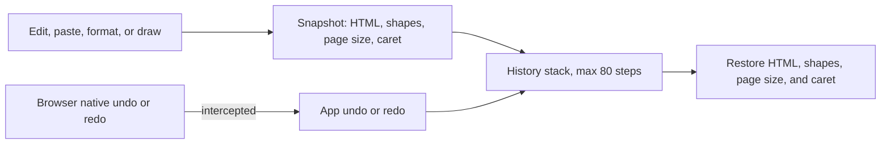
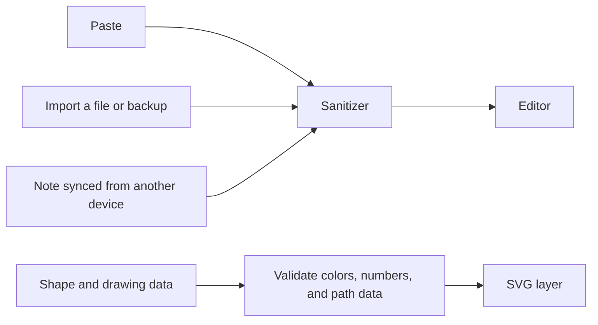
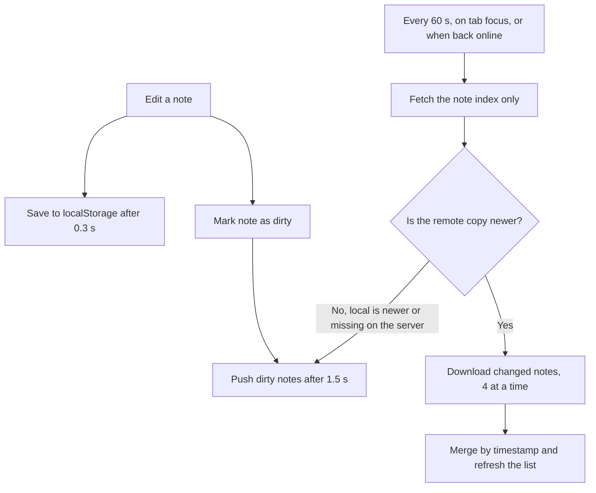

# Engineering notes

A notepad looks simple, but several parts are harder than they appear. This page expands the decisions summarized in the [README](../README.md): the challenge, the solution, and the trade-off for each.

To follow along in the source, search `public/index.html` for these section comments: *Sanitizer*, *Backend sync*, *Undo / redo*, and *shapes and freehand drawing*.

## 1. Local-first architecture

**Challenge.** Notes should be available instantly, and the app should keep working with no server and no account.

**Solution.** Every edit is saved to `localStorage` about 0.3 seconds after typing stops. Preferences such as theme, font, and zoom are stored the same way. Cloud sync is a separate, optional layer that reads from and writes to this local store; it never replaces it.

**Trade-off.** Browser storage is limited and tied to one browser profile. The app therefore offers **Backup all** (a dated JSON file) and shows a warning when the browser reports that storage is full.

## 2. Offline support and PWA

**Challenge.** The app should open and work with no connection, and feel like an installed app on phones and desktops.

**Solution.**

- A web manifest sets standalone display, icons, and a **New note** shortcut that opens `/?new=1`.
- A service worker, registered only on secure origins, lets the installed app reopen offline.
- An in-app install prompt appears when the browser offers one and is snoozed for seven days if dismissed. On iOS, where that prompt doesn't exist, the app shows Add to Home Screen guidance.

**Trade-off.** Offline use covers the app shell and the notes already stored on the device. Sync needs a connection, and installation requires HTTPS.

## 3. Undo and redo history

**Challenge.** The browser's built-in undo only understands text edits inside the editor. It knows nothing about shapes, drawings, or page-size changes, so undoing after drawing would do the wrong thing.

**Solution.** The app keeps its own snapshot history. Each snapshot stores the note's HTML, its shape and drawing data, the page size, and the caret position. Snapshots are recorded shortly after changes and explicitly before actions such as paste and formatting. The browser's native undo and redo events are intercepted and routed through this history, and on restore the caret is placed back by text offset. Memory is bounded: 80 steps per note, reduced to 15 for very large notes.

**Trade-off.** Full snapshots are simpler and more reliable than diffs, but use more memory on large notes, which is why the history is capped.

## 4. Handling pasted and imported HTML

**Challenge.** A rich-text editor takes HTML from many places: the clipboard, imported files, backup JSON, and notes synced from another device. Any of them can carry scripts or malformed data.

**Solution.**

- All HTML goes through a sanitizer that removes scripts, styles, iframes, objects, embeds, forms, and similar elements, plus event-handler attributes and `javascript:` links. It runs on paste, file import, and backup restore, **and again when a note is opened**, so content synced from elsewhere is cleaned too.
- Plain-text paste is escaped and converted to HTML in a way that keeps line breaks, tabs, and repeated spaces.
- Shape and drawing data is validated separately before it reaches the SVG layer: colors must match a hex pattern, numbers are coerced, shape names are reduced to word characters, and freehand path data is restricted to path commands and digits.

**Trade-off.** The sanitizer is blocklist-based: lightweight and dependency-free, but an allowlist library such as DOMPurify is stricter and is a sensible next step.

## 5. Cloud-sync conflict resolution

**Challenge.** Let people use the same notes on several devices with no sign-up, and never lose an edit when the network drops or two devices disagree.

**Solution.**

- **Dirty tracking.** A changed note stays "dirty" until it has been pushed, about 1.5 seconds after the last edit. Temporary failures (network, server) keep the note dirty and it is retried. Permanent ones (a note that is too large, a rejected note, the 500-note limit) don't loop forever; they show a clear message.
- **Cheap pulls.** The client fetches only a compact index of notes, downloads just the ones newer than its local copy (four at a time), and pushes anything the server has older or is missing. This runs every 60 seconds while the tab is visible, when you return to the tab, and when the browser comes back online. A guard stops two syncs from overlapping.
- **Conflicts and deletions.** Each note resolves by timestamp, last write wins. Deleted notes become tombstones, so a deletion on one device isn't undone by another.
- **A key that is easy to check.** The app normalizes the sync key and shows a short **Key ID** (the first bytes of its SHA-256 hash), so two devices can be compared without revealing the key. The share link carries the key in the URL fragment, which the app removes from the address bar after reading, and the app asks before merging if a different key is already active.
- The starter "Welcome" note is dropped automatically once real synced notes arrive, so a new device doesn't start with clutter.

**Trade-off.** Per-note last-write-wins using device clocks is simple and predictable, but concurrent edits to the same note can overwrite each other, and badly skewed clocks can pick the wrong winner. Real-time collaborative editing would need a different model (CRDT or operational transforms), which was out of scope.

## 6. A drawing layer that stays accurate under zoom and print

**Challenge.** Shapes and pen strokes sit on top of editable text. They have to stay editable, land under the pointer at any zoom level, and print on the right page size.

**Solution.**

- Shapes and strokes are stored as **data** (JSON saved with the note), not as pictures, so they stay selectable, movable, and resizable, and they sync like any other note content.
- Pointer coordinates are converted back through the zoom factor, so shapes land under the pointer from 25% to 300%. Pointer capture and disabled touch scrolling on the drawing layer keep drawing and dragging smooth on touch screens.
- Page sizes are CSS-based, and a matching print page size is generated for the selected size, so print and Save as PDF follow the on-screen page. At 100% zoom, paper-sized pages scale down to fit the screen.

**Trade-off.** The eraser tests distance to recorded stroke points. That is fast and simple, but less precise on very fast strokes whose points are far apart.
